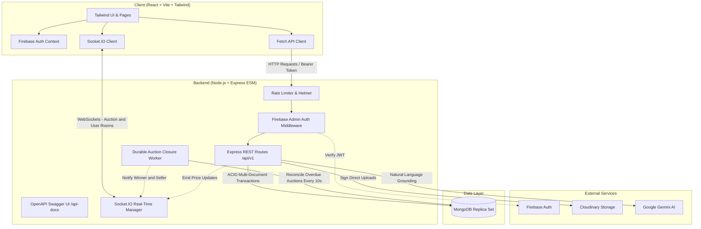

# 🎓 CampusBid — Real-Time Campus Auction Marketplace

[](https://nodejs.org/)
[](https://react.dev/)
[](https://vitejs.dev/)
[](https://tailwindcss.com/)
[](https://expressjs.com/)
[](https://www.mongodb.com/)
[](https://socket.io/)
[](https://firebase.google.com/)
[](https://vitest.dev/)
[](https://opensource.org/licenses/MIT)

> **CampusBid** is an enterprise-grade, real-time second-hand auction marketplace engineered specifically for university campuses. Designed for fairness, consistency, anti-sniping protection, and monetary integrity, it connects student sellers and buyers for transparent, physical on-campus exchanges.

---

## 📑 Table of Contents

- [Key Highlights](#-key-highlights)
- [System Architecture](#-system-architecture)
- [Core Features](#-core-features)
  - [Live Bidding & Anti-Sniping](#1-real-time-bidding--anti-sniping-soft-close)
  - [Proxy AutoBidding](#2-proxy-autobidding-engine)
  - [Monetary Precision](#3-zero-floating-point-monetary-precision)
  - [Dual-Confirmation Handover](#4-dual-confirmation-post-auction-handover)
  - [AI Campus Assistant](#5-ai-campus-shopping-assistant)
  - [Community Q&A with Smart Deduplication](#6-community-qa-with-duplicate-detection)
  - [Watchlists & Real-Time Alerts](#7-watchlists-saved-searches--notifications)
- [Tech Stack](#-tech-stack)
- [Monorepo Directory Structure](#-monorepo-directory-structure)
- [Getting Started](#-getting-started)
  - [Prerequisites](#prerequisites)
  - [Installation](#installation)
  - [Environment Configuration](#environment-configuration)
  - [Running the Application](#running-the-application)
- [Automated Testing](#-automated-testing)
- [Interactive API Documentation](#-interactive-api-documentation)
- [API Overview](#-api-overview)
- [WebSocket Real-Time Events](#-websocket-real-time-events)
- [Security & Best Practices](#-security--best-practices)
- [License](#-license)

---

## 🌟 Key Highlights

- ⚡ **Real-Time Bidding via WebSockets**: Instant bid synchronization, countdown timers, and active bidder tracking powered by Socket.IO.
- 🛡️ **Anti-Sniping (Soft-Close) Engine**: Eliminates last-second bot sniping by automatically extending the auction deadline by 60 seconds whenever a bid is accepted within the final 30 seconds.
- 🤖 **Private Proxy AutoBidding**: Set a secret maximum ceiling; the authoritative backend incrementally outbids competitors on your behalf while strictly guarding your ceiling from public APIs and sockets.
- 💰 **Paise Monetary Precision**: Eliminates JavaScript IEEE 754 floating-point rounding errors by calculating and storing all currency values as integer **paise** ($1\text{ INR} = 100\text{ paise}$).
- 🔒 **ACID Transaction Safety**: All bidding sequences, price updates, and auction extensions execute inside MongoDB multi-document transactions with atomic rollback on contention.
- 🤝 **Dual-Confirmation Physical Handover**: Protects student buyers and sellers with a multi-step post-auction resolution lifecycle (Approved $\rightarrow$ Reserved $\rightarrow$ Dual In-Person Confirmation $\rightarrow$ Completed).
- 🧠 **Grounded Gemini AI Assistant**: Natural language search and bid advisory integrated with Google Gemini (`gemini-1.5-flash`), answering student queries based strictly on active campus listings.
- 💬 **Intelligent Community Q&A**: Listing-level public inquiries featuring automated question deduplication that reuses existing seller answers.
- 📖 **Interactive Swagger UI**: Full OpenAPI 3.0 specification with built-in mock token authentication for effortless endpoint experimentation.

---

## 🏛️ System Architecture



---

## 🚀 Core Features

### 1. Real-Time Bidding & Anti-Sniping (Soft-Close)
- Real-time bid propagation broadcast to all active auction room viewers via `auction:bid` and `auction:update`.
- If a competitive bid lands within **30 seconds** of auction conclusion, the authoritative server automatically pushes the closing timestamp by **60 seconds**, guaranteeing every student an opportunity to respond.

### 2. Proxy AutoBidding Engine
- Allows students attending classes or exams to configure a private ceiling (`maxAmountPaise`).
- When a competitor places a bid, the backend automatically places the minimum necessary counter-bid up to the configured ceiling.
- **Privacy Guaranteed**: Ceilings are never included in public REST payloads or WebSocket broadcasts, and deterministic tie-breaking favors earlier timestamps.

### 3. Zero Floating-Point Monetary Precision
- Bypasses traditional float precision pitfalls (e.g. `0.1 + 0.2 !== 0.3`) by storing all values as integer **paise**:
  $$\text{Amount (Paise)} = \text{Amount (Rupees)} \times 100$$
- Example: A starting price of ₹250.00 is strictly tracked as `25000` paise.

### 4. Dual-Confirmation Post-Auction Handover
- Once an auction closes, a structured `Sale` record is created.
- The seller reviews and approves or rejects the final winning bid.
- Upon approval, the item transitions to `RESERVED`.
- Both buyer and seller meet on campus and independently submit their handover confirmation, moving the status to `COMPLETED`.

### 5. AI Campus Shopping Assistant
- Powered by Google Gemini (`gemini-1.5-flash`), with automated fallback to Groq and Mock providers.
- Accepts natural language queries like *"Find me a mountain cycle under ₹3,500"* or *"Is there any scientific calculator in like-new condition?"*.
- Cross-references real MongoDB catalog items to synthesize structured recommendations with actionable bid proposal modals.

### 6. Community Q&A with Duplicate Detection
- Prospective bidders can ask questions about item condition, accessories, or pickup spots.
- The system checks for semantic or exact duplicate questions on the listing: if already answered by the seller, the existing answer is delivered instantly without notifying the seller again.

### 7. Watchlists, Saved Searches & Notifications
- Add listings to a personal watchlist with one click.
- Create saved search alerts with maximum price thresholds.
- Receive instant in-app alerts for outbid events, auction wins, handover updates, and seller responses.

---

## 🛠️ Tech Stack

| Domain | Technology | Description |
|---|---|---|
| **Frontend Framework** | [React 18](https://react.dev/) + [Vite 6](https://vitejs.dev/) | High-performance SPA with instant HMR |
| **Styling** | [Tailwind CSS 3](https://tailwindcss.com/) | Modern utility-first design with curated color palettes |
| **Icons & UI** | [Lucide React](https://lucide.dev/) | Clean, consistent vector iconography |
| **Routing** | [React Router v7](https://reactrouter.com/) | Client-side routing with guarded private routes |
| **Backend Framework** | [Node.js](https://nodejs.org/) + [Express 4](https://expressjs.com/) | Modular JavaScript (ES Modules) architecture |
| **Database** | [MongoDB](https://www.mongodb.com/) + [Mongoose 8](https://mongoosejs.com/) | Document store with replica set multi-document ACID transactions |
| **Real-Time Communication** | [Socket.IO 4](https://socket.io/) | Bi-directional WebSocket channels with room multiplexing |
| **Authentication** | [Firebase Auth](https://firebase.google.com/) + Admin SDK | Secure Google Sign-In & Email/Password with JWT validation |
| **Asset Management** | [Cloudinary](https://cloudinary.com/) | Backend-signed client uploads for media assets |
| **AI Engine** | [Google Gemini](https://ai.google.dev/) / [Groq](https://groq.com/) | Grounded natural language catalog query and bid analysis |
| **API Documentation** | [Swagger UI](https://swagger.io/) + OpenAPI 3.0 | Interactive in-browser endpoint testing explorer |
| **Testing** | [Vitest](https://vitest.dev/) + [Supertest](https://github.com/ladjs/supertest) | Fast test runner with in-memory MongoDB replica set |

---

## 📂 Monorepo Directory Structure

```text
The Cloud Company/
├── .env.example                  # Root environment template
├── package.json                  # Monorepo workspaces definition
├── README.md                     # Project documentation
│
├── client/                       # Frontend Single Page Application
│   ├── index.html                # Entry HTML document
│   ├── package.json              # Client dependencies & scripts
│   ├── tailwind.config.js        # Tailwind design configuration
│   ├── vite.config.js            # Vite build and dev configuration
│   └── src/
│       ├── App.jsx               # Application root & route definitions
│       ├── main.jsx              # DOM root mount
│       ├── index.css             # Base styles & Tailwind directives
│       ├── components/           # Shared UI components
│       │   ├── Navbar.jsx        # Navigation bar with notification badge & search
│       │   ├── Footer.jsx        # Footer with campus links & status
│       │   └── ProtectedRoute.jsx# Firebase auth-guard wrapper
│       ├── contexts/             # Global React Contexts
│       │   ├── AuthContext.jsx   # Firebase state & MongoDB user sync
│       │   └── SocketContext.jsx # Socket.IO connection & room hooks
│       ├── pages/                # Application Views
│       │   ├── Marketplace.jsx   # Search, filters, grid & sorting
│       │   ├── AuctionDetails.jsx# Live bidding interface, Q&A, bid ledger
│       │   ├── CreateListing.jsx # Multi-image upload & listing form
│       │   ├── SellerDashboard.jsx# Listing management & sale approvals
│       │   ├── BuyerDashboard.jsx # Active bids, won items & handovers
│       │   ├── AiAssistantPage.jsx# Interactive Gemini AI search assistant
│       │   ├── WatchlistPage.jsx # Bookmarked auctions
│       │   ├── NotificationsPage.jsx# Notification center with mark-all-read
│       │   ├── Login.jsx         # Sign in with Google / Email
│       │   └── Register.jsx      # New account registration
│       └── services/
│           ├── api.js            # Centralized API fetch layer
│           └── firebase.js       # Client Firebase SDK configuration
│
├── server/                       # Authoritative Backend Service
│   ├── package.json              # Server dependencies & scripts
│   ├── vitest.config.js          # Server test configuration
│   ├── tests/                    # Vitest integration test suite (41 tests)
│   │   ├── auth.test.js          # Auth & user sync tests
│   │   ├── bidding.test.js       # Transaction-safe bidding & proxy tests
│   │   ├── closure.test.js       # Overdue auction closure worker tests
│   │   ├── community_ai.test.js  # Q&A deduplication & AI assistant tests
│   │   ├── health.test.js        # Health check & database status tests
│   │   ├── listings.test.js      # CRUD listing lifecycle tests
│   │   └── models.test.js        # Mongoose schema validations
│   └── src/
│       ├── app.js                # Express app setup, security & Swagger mount
│       ├── server.js             # HTTP/Socket server bootstrapping & shutdown
│       ├── config/               # Environment, database & Swagger definitions
│       │   ├── db.js             # Mongoose connection with replica set support
│       │   ├── env.js            # Type-validated environment variables
│       │   └── swagger.js        # OpenAPI 3.0 specification & Swagger UI
│       ├── controllers/          # Request handlers
│       │   ├── aiController.js   # Gemini query grounding & bid proposals
│       │   ├── bidController.js  # Manual bidding & proxy autobid execution
│       │   ├── communityController.js # Questions, answers & deduplication
│       │   ├── listingController.js   # Search, create, update, cancel listings
│       │   ├── saleController.js # Post-auction approvals & dual handover
│       │   ├── uploadController.js    # Cloudinary signed upload generation
│       │   └── userController.js # Profile sync, preferences & public views
│       ├── jobs/
│       │   └── closureWorker.js  # Background interval for overdue auctions
│       ├── middleware/
│       │   ├── auth.js           # Firebase JWT verification & mock bypass
│       │   ├── errorHandler.js   # Standardized error responder
│       │   ├── notFound.js       # 404 handler
│       │   └── rateLimiter.js    # Express rate limiting
│       ├── models/               # Mongoose Schemas
│       │   ├── AutoBid.js        # Private proxy bid ceilings
│       │   ├── Bid.js            # Append-only immutable bid ledger
│       │   ├── Listing.js        # Auction metadata & current high bid
│       │   ├── Notification.js   # In-app alerts
│       │   ├── Question.js       # Listing Q&A entries
│       │   ├── Sale.js           # Post-auction handover state machine
│       │   ├── SavedSearch.js    # User-defined search alert criteria
│       │   └── User.js           # Student profiles & preferences
│       ├── routes/               # Express modular route definitions
│       ├── services/             # Core business logic
│       │   ├── aiService.js      # Gemini / Groq / Mock integration
│       │   ├── biddingService.js # ACID-safe bidding & anti-sniping extension
│       │   └── closureService.js # Deterministic winner resolution
│       ├── sockets/
│       │   └── socketManager.js  # Socket.IO connection & room broadcast logic
│       └── validators/           # Zod schema validation rules
│
└── docs/
    └── architecture.md           # Architecture notes & design principles
```

---

## ⚡ Getting Started

### Prerequisites

- **Node.js**: `v18.0.0` or higher
- **npm**: `v9.0.0` or higher
- **MongoDB**: A running MongoDB instance configured as a **Replica Set** (required for multi-document ACID transactions). Alternatively, use a free cloud cluster from [MongoDB Atlas](https://www.mongodb.com/atlas) (replica set enabled by default).
- **Firebase Project**: A Firebase project with Authentication enabled (Google and Email/Password).
- **Cloudinary Account**: (Optional for production image storage, mock uploads supported for testing).

### Installation

Clone the repository and install all dependencies for both `server` and `client` via npm workspaces from the root:

```bash
git clone https://github.com/lokesh-34/Campus_auction.git
cd Campus_auction

# Install all workspace dependencies
npm install
```

### Environment Configuration

#### 1. Server Configuration (`server/.env`)
Create `server/.env` based on `.env.example`:

```env
NODE_ENV=development
PORT=5000
CLIENT_URL=http://localhost:5173

# MongoDB Connection (Replica Set required for transactions)
MONGODB_URI=mongodb://localhost:27017/campusbid?replicaSet=rs0
# Or MongoDB Atlas:
# MONGODB_URI=mongodb+srv://<user>:<password>@cluster.mongodb.net/campusbid?retryWrites=true&w=majority

# Firebase Admin SDK
FIREBASE_AUTH_MOCK=false
FIREBASE_SERVICE_ACCOUNT_PATH=../google-key.json
FIREBASE_PROJECT_ID=your-firebase-project-id

# Cloudinary Storage
CLOUDINARY_CLOUD_NAME=your_cloud_name
CLOUDINARY_API_KEY=your_api_key
CLOUDINARY_API_SECRET=your_api_secret
MAX_FILE_SIZE_BYTES=5242880
MAX_IMAGES_PER_LISTING=5

# AI Assistant Configuration
AI_PROVIDER=gemini
AI_API_KEY=your_gemini_api_key
AI_MODEL=gemini-1.5-flash
```

> **Note on Mock Authentication:** If developing without a Firebase service account, you can set `FIREBASE_AUTH_MOCK=true`. You can then supply mock bearer tokens in requests, e.g. `Bearer mock:user_123:student@campus.edu:John`.

#### 2. Client Configuration (`client/.env`)
Create `client/.env`:

```env
VITE_API_BASE_URL=http://localhost:5000/api/v1
VITE_SOCKET_URL=http://localhost:5000
VITE_FIREBASE_API_KEY=your_firebase_api_key
VITE_FIREBASE_AUTH_DOMAIN=your_project.firebaseapp.com
VITE_FIREBASE_PROJECT_ID=your_project_id
VITE_FIREBASE_STORAGE_BUCKET=your_project.firebasestorage.app
VITE_FIREBASE_MESSAGING_SENDER_ID=your_sender_id
VITE_FIREBASE_APP_ID=your_app_id
```

### Running the Application

You can launch both server and client directly from the root workspace:

```bash
# Start backend server (runs on http://localhost:5000)
npm run dev:server

# In a separate terminal, start frontend client (runs on http://localhost:5173)
npm run dev:client
```

Now open [http://localhost:5173](http://localhost:5173) in your browser.

---

## 🧪 Automated Testing

The backend includes a comprehensive automated test suite powered by **Vitest**, **Supertest**, and **mongodb-memory-server** (which automatically provisions an in-memory replica set to test ACID transactions):

```bash
# Run all server integration and unit tests
npm run test:server
```

### Test Coverage Highlights (41 Tests Passing)
- **`health.test.js`**: Uptime, service health, and database connectivity.
- **`auth.test.js`**: Firebase token validation, mock bypass, and MongoDB user sync.
- **`models.test.js`**: Schema validations, enum constraints, and default values.
- **`listings.test.js`**: Auction creation, filtering, query pagination, and cancellation restrictions.
- **`bidding.test.js`**:
  - ACID transaction rollback on conflict.
  - Manual bids higher than current price + increment.
  - Proxy autobidding incremental counter-bids.
  - Soft-close 60-second anti-sniping extension within final 30 seconds.
  - Private max ceiling confidentiality.
- **`closure.test.js`**: Durable background reconciliation worker and winner/reserve price resolution.
- **`community_ai.test.js`**:
  - Duplicate question detection and auto-reuse of existing seller answers.
  - Route novel questions to seller.
  - Grounded Gemini AI natural language search queries.

---

## 📖 Interactive API Documentation

CampusBid provides an interactive Swagger UI for real-time testing and specification inspection.

- **Swagger UI Explorer**: [http://localhost:5000/api-docs](http://localhost:5000/api-docs)
- **OpenAPI 3.0 JSON Spec**: [http://localhost:5000/api-docs.json](http://localhost:5000/api-docs.json)

### Authorizing in Swagger UI
1. Click the green **Authorize** button at the top right of `/api-docs`.
2. Enter a mock bearer token (e.g., `mock:seller_1:seller@campus.edu:DemoSeller` or `mock:buyer_1:buyer@campus.edu:DemoBuyer`) or a valid Firebase ID Token.
3. Test any protected endpoint directly from the browser.

---

## 🌐 API Overview

All REST endpoints are namespaced under `/api/v1`:

### 🧑‍💼 Users & Authentication
| Method | Endpoint | Description | Auth Required |
|---|---|---|:---:|
| `POST` | `/users/sync` | Sync Firebase authenticated user with MongoDB | Yes |
| `GET` | `/users/me` | Fetch current user profile and preferences | Yes |
| `PATCH` | `/users/me` | Update display name and notification preferences | Yes |
| `GET` | `/users/:id/public` | Retrieve public seller profile | No |

### 🏷️ Listings
| Method | Endpoint | Description | Auth Required |
|---|---|---|:---:|
| `GET` | `/listings` | Search and filter active auctions (category, query, sort, price) | No |
| `POST` | `/listings` | Create a new auction listing | Yes |
| `GET` | `/listings/:id` | Fetch full auction details and public bid history | No |
| `PATCH` | `/listings/:id` | Update listing details (title, description, condition) | Yes (Seller) |
| `POST` | `/listings/:id/cancel` | Cancel an active listing with a reason | Yes (Seller) |
| `GET` | `/listings/seller/me` | Fetch all listings created by the current seller | Yes |

### 🔨 Bidding & AutoBid
| Method | Endpoint | Description | Auth Required |
|---|---|---|:---:|
| `POST` | `/listings/:id/bids` | Place a manual bid (ACID safe, anti-sniping enabled) | Yes |
| `GET` | `/listings/:id/bids` | Retrieve immutable bid ledger for a listing | No |
| `POST` | `/listings/:id/autobid` | Set private proxy AutoBid ceiling | Yes |
| `GET` | `/listings/:id/autobid` | Fetch current user's AutoBid configuration | Yes |
| `DELETE`| `/listings/:id/autobid` | Disable current user's AutoBid configuration | Yes |

### 🤝 Sales & Handover
| Method | Endpoint | Description | Auth Required |
|---|---|---|:---:|
| `GET` | `/sales/my` | Retrieve sales history (`?role=all\|seller\|buyer`) | Yes |
| `GET` | `/sales/:id` | Retrieve single sale record and handover status | Yes |
| `POST` | `/sales/:id/approve` | Seller approves winning bid (transitions to `RESERVED`) | Yes (Seller) |
| `POST` | `/sales/:id/reject` | Seller rejects bid below expectation | Yes (Seller) |
| `POST` | `/sales/:id/confirm-handover` | Dual confirmation of in-person exchange | Yes (Participant) |
| `POST` | `/sales/:id/cancel` | Cancel active sale before handover | Yes (Participant) |

### ❓ Community Q&A
| Method | Endpoint | Description | Auth Required |
|---|---|---|:---:|
| `GET` | `/listings/:id/questions` | Get public questions and answers for a listing | No |
| `POST` | `/listings/:id/questions` | Ask the seller a question (with auto-deduplication) | Yes |
| `POST` | `/questions/:id/answer` | Seller answers a question | Yes (Seller) |

### 🤖 AI Assistant & Uploads
| Method | Endpoint | Description | Auth Required |
|---|---|---|:---:|
| `POST` | `/ai/query` | Natural language search grounded in catalog listings | No |
| `POST` | `/ai/propose-bid` | Generate structured bid proposals with confirmation data | Yes |
| `POST` | `/uploads/sign` | Generate Cloudinary signed parameters for direct upload | Yes |
| `POST` | `/uploads/mock-upload` | Simulate upload for development testing | Yes |

---

## 📡 WebSocket Real-Time Events

The server provides real-time event broadcasting over Socket.IO:

| Event Name | Direction | Payload | Purpose |
|---|:---:|---|---|
| `auction:join` | Client $\rightarrow$ Server | `listingId: string` | Subscribe to a specific auction room |
| `auction:leave` | Client $\rightarrow$ Server | `listingId: string` | Unsubscribe from an auction room |
| `user:join` | Client $\rightarrow$ Server | `userId: string` | Join private notification channel |
| `auction:bid` | Server $\rightarrow$ Room | `{ listingId, amountPaise, bidderName, bidCount, currentPricePaise }` | Broadcast new accepted bid |
| `auction:extended` | Server $\rightarrow$ Room | `{ listingId, closingAt, reason: "ANTI_SNIPING_EXTENSION" }` | Notify room of anti-sniping soft-close |
| `auction:closed` | Server $\rightarrow$ Room | `{ listingId, status: "CLOSED", winnerId, finalPricePaise }` | Broadcast auction termination |
| `notification:new` | Server $\rightarrow$ User | `{ id, type, title, message, link }` | Push real-time outbid/handover alert |

---

## 🛡️ Security & Best Practices

- **Strict ACID Transactions**: Guarantees zero race conditions on concurrent bids.
- **Private Ceiling Secrecy**: Proxy autobid maximums are isolated in a separate collection (`AutoBid`) and never projected in listing queries or socket updates.
- **Content Security & Headers**: Express configured with `helmet` and custom CORS policies permitting only authorized origins.
- **Request Throttling**: Protected against abuse via `express-rate-limit`.
- **Signed Cloudinary Uploads**: Images are sent directly from the client to Cloudinary using cryptographically signed signatures generated by the backend, ensuring API secret keys never touch the client.
- **Data Validation**: Strict input parsing and schema verification using `zod` and Mongoose schema validators.

---

## 📄 License

This project is licensed under the [MIT License](LICENSE).

---

<p align="center">
  Crafted with ❤️ by the <b>CampusBid Team</b> &mdash; Empowering student communities with transparent, fair, and modern commerce.
</p>
